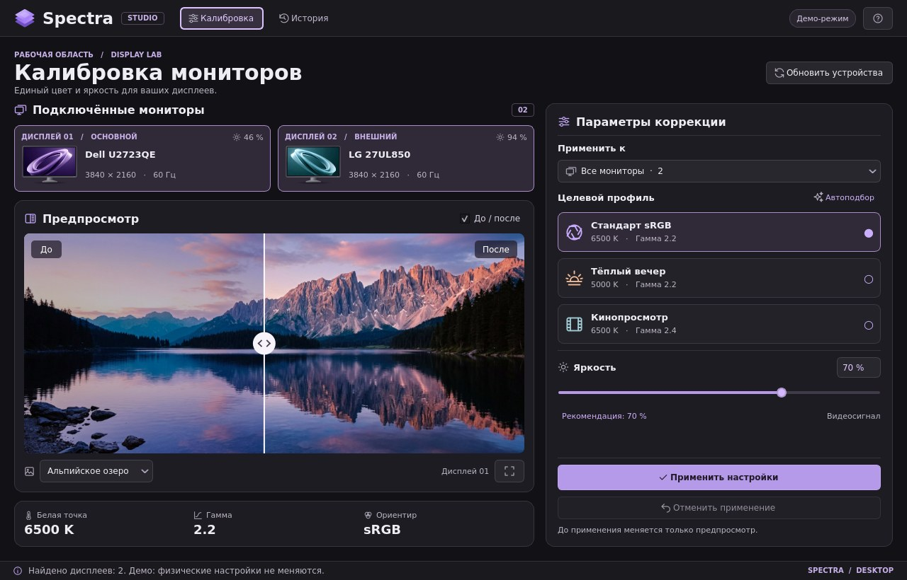

# Spectra Studio

Приложение на **Python 3.12** для согласования белой точки, гаммы и яркости подключённых мониторов. Настольная версия использует **PySide6 / Qt Widgets**: это настоящее окно, без браузера, WebView и HTTP-сервера. Для облачного предпросмотра и работы без Qt сохранена отдельная веб-версия. Обе используют один движок коррекции и один формат журнала.

## Быстрый запуск в Windows: один .bat

1. **[Скачайте Start-Spectra.bat](https://github.com/Ven4esters/monitor-color-corrector/raw/refs/heads/arena/4aba3c52-monitor-color-corrector/Start-Spectra.bat)** в отдельную папку, куда у вас есть право записи. Если проект уже распакован, используйте `Start-Spectra.bat` из его корня.
2. Запустите файл двойным щелчком. Нужен **64-битный Python 3.12**. Скрипт проверит `py -3.12`, стандартную пользовательскую установку и `python` из PATH. Если Python не найден и доступен `winget`, скрипт предложит установить его **только с вашего согласия**; иначе покажет инструкцию.
3. При первом запуске рядом с `.bat` появится `.venv`. Скрипт запустит `pip` именно этого окружения: установит PySide6-Essentials 6.10.3 с shiboken6 и приложение с его ресурсами. Если рядом нет исходников, пакет берётся из [зафиксированной ревизии проекта](https://github.com/Ven4esters/monitor-color-corrector/tree/4d3000f6d79bcf2ca72fdf2c1f8e269c3d15f474) по HTTPS. Git, ручное скачивание картинок и активация venv не нужны.
4. Откроется **нативное окно Spectra Studio**, а не вкладка браузера. При следующем запуске проверяются версия окружения, импорты и ресурсы. Если всё готово, установка пропускается и интернет не нужен.

```bat
rem Обычный запуск
Start-Spectra.bat
rem Виртуальные дисплеи, без доступа к оборудованию
Start-Spectra.bat --demo
rem Проверить установку и выйти
Start-Spectra.bat --check
```

В PowerShell добавьте `.\` перед именем файла. Скрипт не устанавливает пакеты в системный Python, не меняет постоянный PATH и не удаляет существующее окружение. При несовместимой/повреждённой `.venv` переименуйте её и запустите `.bat` ещё раз. При сбое загрузки проверьте доступ к PyPI и GitHub. Для автоматизации `SPECTRA_NO_PAUSE=1` отключает паузу при ошибках и предложение установить Python; код возврата остаётся ненулевым при сбое.

## Настольное приложение



### Запуск из исходников

В Windows с установленным 64-битным Python 3.12, из каталога проекта:

```bat
py -3.12 -m venv .venv
.venv\Scripts\python -m pip install ".[desktop]"
.venv\Scripts\python -m spectra.desktop
```

В Linux используйте `python3.12 -m venv .venv`, затем `.venv/bin/python -m pip install ".[desktop]"` и `.venv/bin/python -m spectra.desktop`. Нужен графический сеанс и системные библиотеки Qt (в т. ч. OpenGL, EGL, xkbcommon и плагин платформы с его зависимостями). Управление реальными выходами Linux поддерживается в X11. Для просмотра без оборудования добавьте `--demo`. Команда `python -m spectra.desktop --check` открывает окно с временными демоданными, проверяет начальную загрузку и выходит, не трогая дисплеи и ваш журнал.

Пакет `PySide6-Essentials` предоставляет официальные модули `PySide6.QtWidgets`, `QtGui`, `QtCore`, `QtSvg` и `QtTest`; Qt WebEngine и весь набор Addons не загружаются. После установки сеть для работы не нужна.

### Работа с окном

Выберите цель в поле **«Применить к»** или нажмите на карточку конкретного дисплея. Ползунок яркости связан с полем точного ввода. Профиль, яркость, тестовое изображение и разделитель «до/после» сначала меняют **только предпросмотр**. При физическом применении окно перечислит затрагиваемые мониторы и попросит подтверждение. Поиск и запись выполняются в отдельном потоке: во время операции нельзя запустить вторую, а закрытие окна дожидается завершения текущей. Если выбранный монитор исчез, приложение попросит выбрать цель заново.

В узком окне панели переходят в одну колонку с прокруткой. `Tab` / `Shift+Tab` перемещают фокус, стрелки меняют яркость и положение разделителя, `Ctrl+R` обновляет устройства, `Ctrl+1` / `Ctrl+2` открывают калибровку / историю, `F1` — справку. Второй экземпляр настольной студии не пишет в тот же журнал.

## Веб-версия (без зависимостей Qt)

**Один файл без установки.** В предпросмотре нажмите **«Демо-режим» → «Скачать .pyz»**. Запустите скачанный `Spectra-Studio.pyz` из папки загрузок командой `py -3.12 Spectra-Studio.pyz` (Windows) или `python3.12 Spectra-Studio.pyz` (Linux). Это ZIP-приложение с исходниками веб-версии, шрифтами и изображениями; журнал и сведения о мониторах в него не попадают. Собрать такой же файл самостоятельно: `python3.12 -m spectra.portable`.

**Из корневой папки проекта:**

```powershell
# Windows, Python Launcher
py -3.12 -m spectra
```

```bash
# Linux
python3.12 -m spectra
```

Откроется **http://127.0.0.1:8765**. Если браузер не открылся автоматически, перейдите по этому адресу. Остановка сервера — `Ctrl+C`. Можно установить приложение в виртуальное окружение (`python -m pip install .`) и запускать командой `spectra`.

**Поддерживаемое оборудование:** Windows с доступом к GDI Gamma Ramp и Linux в сеансе **X11** с системными библиотеками `libX11.so.6`, `libXrandr.so.2` и RandR ≥ 1.3. Используйте обычный SDR-режим и расширенный рабочий стол. Права администратора не требуются. Для аппаратной яркости внешнего монитора включите **DDC/CI** в его экранном меню. В Windows используется системный Monitor Configuration API; в Linux требуется дополнительно установленная утилита `ddcutil` и доступ пользователя к соответствующей I²C-шине. Без них доступна программная яркость через LUT.

```bash
# Виртуальные дисплеи; этот режим вообще не обращается к оборудованию
python3.12 -m spectra --demo

# Другой порт, без автоматического открытия браузера
python3.12 -m spectra --port 8800 --no-browser

# Демонстрация по сети / в облачном предпросмотре
python3.12 -m spectra --demo --host 0.0.0.0 --port 8765 --no-browser
```

В режиме без графического сеанса, на Wayland и на неподдерживаемой ОС студия явно показывает **«Демо-режим»** и два виртуальных дисплея. Облачный предпросмотр не обнаруживает мониторы компьютера посетителя. В веб-версии аппаратное управление доступно только через локальный сервер; сетевой запуск разрешён исключительно с `--demo`.

## Рабочий процесс

1. **Обновить устройства** — прочитать активные выходы, модели из EDID, разрешения, частоты, гамма-таблицы и, при поддержке DDC/CI, текущую яркость подсветки. При отсутствии имени используется идентификатор производителя/модели либо системное имя. Отключённые выходы исключаются.
2. **Применить к** — выбрать «Оба сразу» / «Все сразу» или конкретный дисплей. Нажатие на карточку монитора тоже выбирает его. При выборе одного монитора остальные не меняются.
3. **Целевой профиль** — выбрать один из трёх вариантов. Для каждой цели рассчитывается своя коррекция, а не копируется одна таблица на все мониторы.

   | Профиль | Белый | Целевая гамма | Назначение |
   | --- | --- | --- | --- |
   | Стандарт sRGB | D65, ≈6500 K | 2.2 | Работа, фотографии и веб |
   | Тёплый вечер | D50, ≈5000 K | 2.2 | Чтение при тёплом освещении |
   | Кинопросмотр | D65, ≈6500 K | 2.4 | Видео в затемнённой комнате |

4. **Яркость** — изменить значение ползунком или числом. Под ползунком показан используемый способ: подсветка, видеосигнал или смешанный режим для нескольких дисплеев. «Автоподбор» возвращает нейтральный профиль и рекомендованный уровень для выбранных устройств. Нажатие на расчётный процент возвращает только яркость.
5. **Предпросмотр** — перетащить границу «до/после», выбрать фото, цветовую или серую шкалу. Есть развёрнутый просмотр, переключатель сравнения и управление стрелками с клавиатуры. При общей настройке сравнение показывает первый выбранный монитор (его номер подписан под изображением). На этом этапе системные настройки не меняются.
6. **Применить настройки** — сохранить исходное состояние, записать и проверить кривые и яркость только выбранных выходов. При работе с реальными мониторами требуется подтверждение.
7. **Отменить изменения** — вернуть **сохранённые** значения, а не заводские настройки. Откат относится ко всей последней операции, независимо от текущего выбора дисплея. История доступна на отдельной вкладке, в том числе после перезапуска приложения.

## Что именно рассчитывается

- Из корректного базового блока EDID берутся паспортная гамма, координаты основных цветов и белой точки. Без этих данных используются ориентиры sRGB/D65/2.2, а не вымышленные измерения.
- В пространстве собственных RGB-примариев дисплея рассчитываются коэффициенты каналов для целевого белого. Отношение целевой гаммы к паспортной определяет кривую полутонов. Результат — три монотонные 16-битные LUT исходной длины, без накопления повторной коррекции.
- Базовая рекомендация яркости опирается на медиану исходных уровней выбранных выходов: нормализованное значение подсветки, когда оно доступно, иначе оценка по LUT. Для вечернего и кинопрофиля предлагаются более низкие уровни. Повторный выбор того же профиля не затемняет экран ещё раз.
- **Аппаратная яркость:** целевой процент переводится в собственный диапазон подсветки конкретного монитора. Гамма-таблица в этом случае отвечает только за цвет; двойного затемнения нет. В Linux DDC/CI-шина сопоставляется с выходом по EDID, в Windows физический дескриптор — по имени GDI-выхода. Неоднозначные соответствия не используются. Сохраняется исходное целое значение подсветки, а не его округлённый процент.
- **Программная яркость:** если управление подсветкой недоступно, регулируется амплитуда видеосигнала. При 0 % оставляется 12 % амплитуды, чтобы не отключить изображение. Показанная яркость — относительный процент, **не** измерение в кд/м². Прошивка и установленные ICC-профили не изменяются.
- Предпросмотр моделирует поведение гамма-таблицы и белой точки на тестовом изображении, а не измеряет экран. Гамма 2.2 — практическое приближение к sRGB, не точная кусочная передаточная функция. Одномерная LUT не меняет физический цветовой охват и не превращает широкогамутную панель в sRGB. **Для гарантированного совпадения цвета и абсолютной яркости нужен колориметр и измеренный ICC-профиль.**

## Безопасность и восстановление

Перед первой записью приложение атомарно сохраняет исходные таблицы и доступные значения подсветки **всех** целей. После записи проверяется чтение (с допуском на округление драйвера). Если второй монитор не принял изменение, студия пытается вернуть исходное состояние каждому уже затронутому выходу. Незавершённая запись остаётся в журнале: новые применения блокируются до отката. Если монитор отключён или изменился размер LUT, подключите его в прежнем режиме и повторите откат.

Хранятся последние 30 операций; отменять их можно в обратном порядке. Запуск и сканирование сами по себе не применяют профили к оборудованию. Используйте один экземпляр студии на графический сеанс.

| Среда | Файлы состояния |
| --- | --- |
| Windows | `%LOCALAPPDATA%\SpectraStudio\displays.json` |
| Linux | `$XDG_STATE_HOME/spectra-studio/displays.json`, по умолчанию `~/.local/state/spectra-studio/displays.json` |
| Деморежим | Отдельный `demo.json` в той же папке |

Каталог можно переопределить переменной `SPECTRA_STATE_DIR`. Не удаляйте журнал, если понадобится восстановление. Дублируемые выходы с общей LUT не настраиваются независимо. HDR, ночной режим, цветовой менеджер ОС или политика драйвера могут блокировать или перезаписывать гамму. Выключите конкурирующую коррекцию или попробуйте менее сильное затемнение; отклонённая драйвером запись не считается успешной.

## Проверка

```bash
python3.12 -m unittest discover -v
```

Для проверки нативного интерфейса предварительно установите `.[desktop]`. Без Qt пропускаются только соответствующие тесты. Тесты не изменяют реальные дисплеи. Проверяются EDID, вычисление кривых и рекомендаций, отдельные и групповые применения, точный откат, сбой во время записи, восстановление после перезапуска, изоляция деморежима, граница HTTP API и работа адаптеров с нативными буферами. В CI предусмотрены Linux и Windows с Python 3.12.

Код: `spectra/backends/` — оборудование и демо; `color.py` — цветовая математика; `studio.py` — операции и журнал; `server.py` — локальный API; `spectra/web/` — веб-интерфейс; `spectra/desktop/` — нативное окно и обработчик операций Qt. Шрифт Manrope распространяется по [SIL OFL 1.1](spectra/web/assets/fonts/OFL.txt). Пейзаж и абстрактные обои — сгенерированные иллюстрации для визуального сравнения, не измерительные эталоны.
